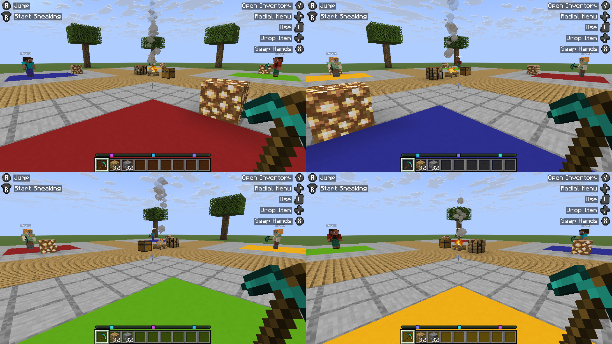
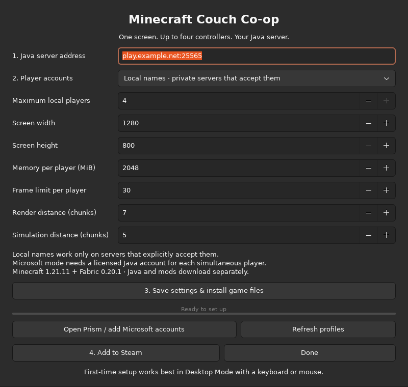
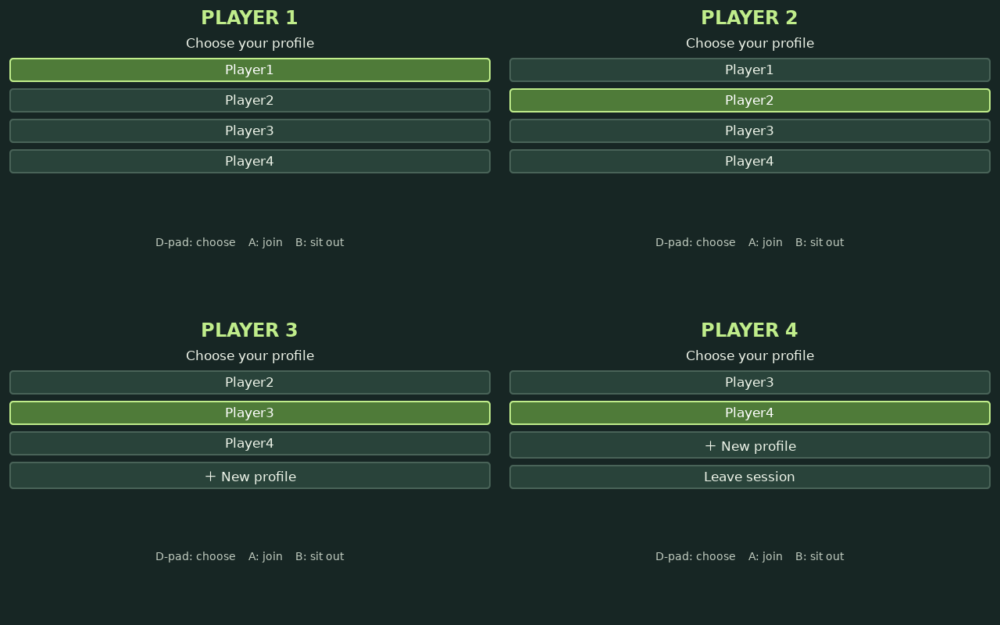
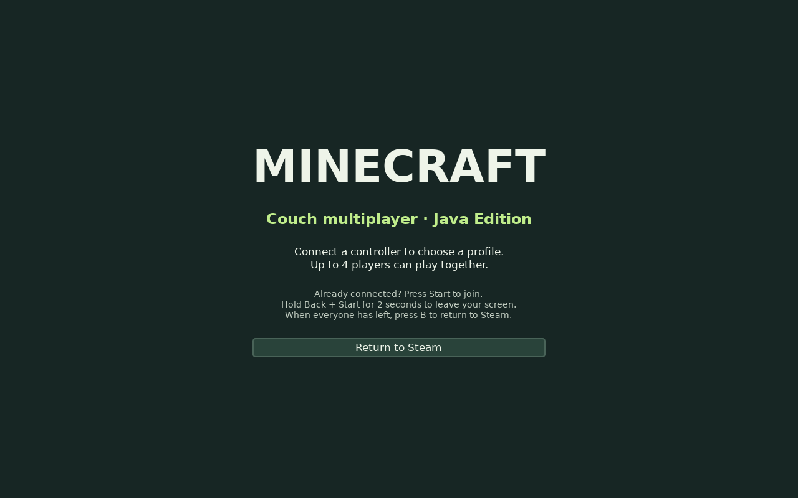

# Minecraft Couch Co-op

**Controller-driven split-screen for Minecraft: Java Edition on SteamOS and KDE Linux.**

Connect a controller, choose a profile, and join your Java server. Other players can join or leave without restarting everyone's game. Launch it from Steam's Gaming Mode like a regular game.



*Actual gameplay after launching the public build through Steam in Gaming Mode. Four automated Linux gamepads drive four independent Minecraft clients in a disposable local demo world, using example profiles.*

> **v0.1.1 is an early preview.** The public build passed a complete four-client test through Steam in Gaming Mode on one SteamOS machine, including independent input, reconnect, and leave/rejoin. That acceptance run used synthetic Linux gamepads; fresh physical-controller combinations and Microsoft sign-in still need coverage. See [validation](docs/VALIDATION.md) for the exact scope.

## What it does

- Runs **one independent Java client per player**, with up to **four local players**.
- Gives each client its own controller, profile, settings, and game directory.
- Automatically arranges one full screen, two horizontal screens, or three/four quadrants.
- Offers a controller-operated profile picker and an on-screen name keyboard.
- Lets a player leave with a button chord and join again later.
- Keeps a player's slot for a short controller disconnect; reconnecting within 15 seconds preserves the client.
- Queues launches so several players do not connect to a rate-limited server simultaneously.
- Downloads Java, Fabric, and controller/performance mods from their publishers, checking publisher hashes.
- Installs into your home directory and adds a non-Steam shortcut without editing Steam's files while Steam is running.

It connects everyone to an **existing Java server**. It does not create a server, turn Java into Bedrock, or add a single-process split-screen engine. Each screen costs roughly another Minecraft client's worth of CPU, GPU, and memory.

## Before you start

| You need | Details |
| --- | --- |
| A Linux gaming machine | Initial target: **x86_64 SteamOS with KDE/KWin**, running Steam natively. Other KDE distributions are experimental. Windows, macOS, ARM, and Flatpak-only Steam are unsupported in this release. |
| Minecraft: Java Edition | Bring your own license. This project distributes no Minecraft game files. |
| An existing Java server | The bundled profile uses **Minecraft 1.21.11 + Fabric Loader 0.20.1**. The server must accept that client version and your chosen account type. Vanilla/Paper-compatible servers need no controller mod. Modded servers may require additional matching client mods. |
| Controllers | One Linux gamepad per player. Use Steam Input's **Gamepad** template for every controller, including handheld controls. Keyboard/mouse emulation layouts cause duplicate or missing input. |
| Memory and graphics headroom | Default maximum Java heap is 2 GiB per player, plus native memory and the OS. 16 GiB is a sensible starting point for four players, not a performance guarantee. |
| Internet for setup | Downloads are several hundred MB or more. Verified files are reused when setup is retried. |
| Desktop Mode once | Use a keyboard/mouse for installation and account sign-in. Normal play then takes place in Gaming Mode. |

### System requirements

The installer checks no system packages into your OS and does not unlock SteamOS's read-only system. Run `minecraft-couch doctor` to find missing requirements:

- Python **3.11+**, with safe `tarfile` extraction support (a maintained Python release).
- GTK 3 and Python GObject introspection (`python-gobject`, `gtk3` on Arch/SteamOS; `python3-gi`, `gir1.2-gtk-3.0` on Debian/Ubuntu).
- `kwin_wayland`, `Xwayland`, `bubblewrap` (`bwrap`), `dbus-run-session`, and `xdotool`.
- A working OpenGL/Mesa driver and `/dev/dri`.
- Linux `uinput` and `joydev`, with permission to read controllers and create virtual controllers.
- For managed Prism: support for running its official x86_64 AppImage, including FUSE.

Package installation depends on your distribution. On SteamOS, first run the doctor; many components may already be present. SteamOS updates can replace manually installed system packages. This project deliberately does not automate package-manager or read-only-root changes.

## Install

1. Switch to **Desktop Mode**.
2. Download `minecraft-couch-coop-0.1.1.tar.gz` and `SHA256SUMS` from the [v0.1.1 preview release](https://github.com/saad780/minecraft-couch-coop/releases/tag/v0.1.1).
3. Open Konsole in the download folder and run:

   ```bash
   sha256sum -c SHA256SUMS
   tar -xzf minecraft-couch-coop-0.1.1.tar.gz
   cd minecraft-couch-coop-0.1.1
   ./install.sh
   ~/.local/bin/minecraft-couch doctor
   ~/.local/bin/minecraft-couch setup
   ```

   Resolve any `CHECK` items relevant to your hardware before playing. With no controller connected yet, the controller checks will naturally be incomplete.

4. In Setup, enter your server address, select an account mode, and choose a display size. Use **1280 × 800** for a Steam Deck's internal screen, or your intended external display size. Three/four-player layouts require at least **1280 × 720**; two players need at least 720 pixels of height. Start with **30 FPS**, **2 GiB per player**, and the supplied render distances.
5. Click **Save settings & install game files** and wait for it to finish. For Microsoft mode, complete the account steps below.
6. Click **Add to Steam**. If Steam is running on SteamOS, the shortcut is queued for its next start. Return to Gaming Mode/restart Steam when convenient. On other Linux desktops, exit Steam fully, run `~/.local/bin/minecraft-couch steam-sync`, then reopen it.
7. Open **Minecraft Couch Co-op** in Steam, choose the **Gamepad** controller template for each controller, and launch it. Use the native Linux shortcut; do not enable Proton for it.



*Actual setup window with an example server address. Replace it with your own.*

You can also install from source with `git clone https://github.com/saad780/minecraft-couch-coop.git`, enter the directory, and run `./install.sh`. No pip environment or Python extension compilation is required.

### Choose the right account mode

**Local names** suit an existing private server that explicitly accepts local/offline identities. The picker starts with Player1–Player4; select **New profile** to create a name. These are local profiles with deterministic offline UUIDs, not Microsoft accounts. Names are 1–16 letters, numbers, or underscores. Keep a name unchanged to retain the same server identity.

Local names cannot authenticate to an online-mode server or Realms. This tool neither changes your server's authentication setting nor bypasses it. Servers accepting unverified names need their own access controls; keep such a server private rather than exposing name-only login publicly.

**Microsoft accounts** use the official [Prism Launcher](https://prismlauncher.org/) for sign-in, ownership checks, and session refresh:

1. Select Microsoft mode and finish the file installation.
2. Click **Open Prism / add Microsoft accounts**.
3. In this project's separate Prism installation, open **Settings → Accounts → Add Microsoft** and finish the browser sign-in. Each simultaneous player needs their own licensed Java profile; you cannot use one profile for several clients at once.
4. Close Prism and click **Refresh profiles** in Setup.
5. In the couch picker, each player chooses their own Minecraft profile.

The project imports only Minecraft profile names and UUIDs. Passwords and refresh/access tokens stay in Prism's account store. Prism may ask you to sign in again if a session expires. Keep a keyboard/mouse available for launcher prompts, particularly the first launch. The managed Prism version is pinned to **11.1.1**; arbitrary launcher/account-store formats are not supported.

## Play together



*Actual picker interface with example profiles and four simulated controller attachments.*



*Actual launcher lobby; game windows appear after players choose a profile.*

| Action | Xbox-style controller |
| --- | --- |
| Get a screen | Connect the controller. A profile picker appears in the next free slot. |
| Choose a profile | D-pad or left stick, then **A** |
| Sit out from the picker | **B** |
| Join again after leaving | **Start/Menu** or **A** |
| Leave only your screen | Hold **Back/View + Start/Menu** together for about **2 seconds** |
| Edit a new local name | D-pad chooses a character; **A** types; **B** erases; **Start** saves. ✓ saves and ✕ cancels. |
| Return to Steam | Once all players have left, press **B**, or use the lobby's Return to Steam button. |

Button labels vary by controller. Up to four controllers can occupy slots; additional controllers wait until a slot is free. A connected player sitting out still owns their slot until they disconnect. This is a four-player implementation, not an unlimited-player launcher.

One client starts at a time. A brief queue is normal, especially on the first launch. Once a client enters the world, the next starts after a five-second gap. A failed connection can remain visible for retry; the queue continues after a one-minute startup fallback.

The game's normal Controlify prompts may appear on first use. Complete any controller selection/download prompt on that player's screen. Press **A** once inside a fresh client if Controlify has not switched to controller input yet. Each client should see exactly **one MC Couch Pad**. The proxy intentionally enables input while its window is unfocused so all screens remain playable.

## Troubleshooting

Run:

```bash
~/.local/bin/minecraft-couch doctor
~/.local/bin/minecraft-couch setup
```

| Symptom | What to check |
| --- | --- |
| Controller moves Steam but not the picker | Set this shortcut's Steam Input layout to **Gamepad** for all controllers. Connect/pair it fully before joining. Run the doctor to check readable gamepads and `/dev/uinput`. |
| One controller controls multiple screens | Each client must see only its assigned proxy. Use the supplied shortcut; do not launch clients independently or add a second remapper. Close other couch sessions. |
| Controls briefly freeze for everyone | Reduce FPS/render distance or player count to distinguish load from input delay. Try USB to distinguish Bluetooth interference. The runtime scans sysfs without reopening every controller and shuts down departing clients in the background. See [controller troubleshooting](docs/CONTROLLERS.md). |
| Older Xbox controller flashes or pairs without input | A solid light and working Linux input events are required. Re-pair only that controller. Some old Bluetooth models need a host-specific ERTM workaround; see the optional, reversible instructions in [CONTROLLERS.md](docs/CONTROLLERS.md). It is never applied automatically. |
| `Invalid session` / authentication failed | An online-mode server needs Microsoft mode and a valid Prism login. Local names work only with a server deliberately configured to accept them. Reauthenticate in Prism, close it, and refresh profiles. Do not paste tokens into config files. |
| `You are already connected` | Choose a different profile for the next player, or wait for the server to remove the previous session after leaving. Do not rapidly reconnect the same identity. |
| Connection throttled | Keep the default launch gap. Some servers/proxies need a longer `join_delay_seconds` in config. Server-specific limits still apply. |
| Version mismatch | This release defaults to 1.21.11. Match your server or use an appropriate separate server. Arbitrary game/mod combinations are not tested. |
| Blank window / returned to Steam | Inspect `logs/session.log`, run the doctor, verify KWin/Xwayland and GPU drivers, and make sure Proton is disabled for the shortcut. |
| Steam shortcut missing | Fully exit Steam, run `minecraft-couch steam-sync`, then reopen it. With multiple Steam users, it targets the most recently used user config. |
| Prism does not open | Check AppImage/FUSE support, then rerun file installation. This release requires the managed native launcher, not a sandboxed Flatpak. |
| Downloads interrupted | Retry Setup. Existing verified files are reused; corrupt or partial downloads are replaced. |

### Controller permissions

The doctor must report writable `/dev/uinput` and readable controller devices. SteamOS often supplies controller rules; check first. On a conventional Linux desktop that lacks suitable rules, an administrator can grant a dedicated group access:

```bash
sudo groupadd -f input
sudo usermod -aG input "$USER"
sudo modprobe uinput
sudo modprobe joydev
```

Add `/etc/udev/rules.d/70-minecraft-couch-input.rules`:

```udev
KERNEL=="uinput", SUBSYSTEM=="misc", GROUP="input", MODE="0660", OPTIONS+="static_node=uinput"
SUBSYSTEM=="input", KERNEL=="event*", GROUP="input", MODE="0660"
SUBSYSTEM=="input", KERNEL=="js*", GROUP="input", MODE="0660"
```

Reload rules with `sudo udevadm control --reload-rules`, reboot, and run the doctor again. If modules do not load after reboot, add `uinput` and `joydev`, one per line, to `/etc/modules-load.d/minecraft-couch.conf`. Membership in `input` permits reading other input devices, including keyboards; use a trusted local account. Remove these custom rules/group membership to undo them if they were added solely for this app. On SteamOS, system updates may replace custom system files.

## Files, privacy, and removal

| Path | Contents |
| --- | --- |
| `~/.local/bin/minecraft-couch` | Launcher command |
| `~/.config/minecraft-couch-coop/config.json` | Server, display, performance, and launcher paths |
| `~/.local/share/minecraft-couch-coop/app/` | Installed program |
| `~/.local/share/minecraft-couch-coop/game/`, `java/`, `mods/` | Managed downloads/cache |
| `~/.local/share/minecraft-couch-coop/players/<name>/` | Local-profile client settings and logs |
| `~/.local/share/minecraft-couch-coop/profiles.json` | Profile names/UUIDs and remembered controller assignments |
| `~/.local/share/minecraft-couch-coop/prism/` | Separate Prism accounts, instances, and cache |
| `~/.local/share/minecraft-couch-coop/logs/` | Launcher and session logs |
| `$XDG_RUNTIME_DIR/minecraft-couch-<uid>/` | Private temporary session state and Prism hand-off requests |

Standard XDG data/config locations are respected. Advanced/test installs can override `MC_COUCH_DATA` and `MC_COUCH_CONFIG`. The app doesn't read another launcher's accounts or change an existing Minecraft installation. It has no project telemetry; downloads, Microsoft/Prism authentication, and your game server make their usual network requests. Logs and profile files can contain names, server addresses, and controller identifiers. Review them before attaching them to an issue. **Never upload Prism's `accounts.json` or the entire data directory.**

To update, exit the game, download a newer release, and run its `install.sh`. Your downloaded games, settings and accounts are retained. The previous program directory remains as `app.previous` until the next update.

To uninstall, fully exit Steam and run:

```bash
~/.local/bin/minecraft-couch uninstall
```

This removes the app, desktop entry, Steam shortcut and its optional SteamOS pre-start hook. It keeps game data/accounts/settings so you can recover them. Delete the data/config directories yourself only when you no longer need them. Steam shortcut backups remain next to Steam's `shortcuts.vdf` with a `couch-backup-…` suffix.

## How it works

```text
Steam / Gaming Mode
  └─ private D-Bus session + nested KWin / Xwayland
       ├─ controller lobby + hotplug + window layout
       ├─ controller 1 → virtual pad 1 → isolated Java client 1 ─┐
       ├─ controller 2 → virtual pad 2 → isolated Java client 2 ─┤
       ├─ controller 3 → virtual pad 3 → isolated Java client 3 ─┼→ your Java server
       └─ controller 4 → virtual pad 4 → isolated Java client 4 ─┘
```

Linux evdev input is forwarded to persistent per-player uinput devices. Bubblewrap gives each Java client its own `/dev` view with just that player's proxy and GPU/audio access. This is **input isolation**, not a security sandbox for untrusted mods: the client retains your normal filesystem access. A KWin script places windows; Controlify handles in-game controller support. Microsoft mode wraps Prism's actual Java process so an already-open Prism GUI cannot accidentally bypass the isolation.

Known limits: four players maximum; no rumble/gyro/touchpad passthrough; no per-player audio routing; no bundled server hosting, Realms picker, or Bedrock support. Controller support depends on Linux and Steam Input. A Bluetooth driver/pairing issue may need machine-specific repair. Suspend/resume, every controller model, every screen size and every distribution are not validated. The new Microsoft backend is experimental.

## Development and credits

```bash
python3 -m unittest discover -s tests -v
python3 -m compileall -q mc_couch
# Optional isolated Linux uinput test (needs device permissions):
MC_COUCH_UINPUT_TEST=1 python3 -m unittest discover -s tests -p test_input.py -v
# Reproduce the interface screenshots with synthetic controller attachments:
xvfb-run -a -s '-screen 0 1440x1000x24' python3 scripts/capture_screenshots.py
```

See [validation](docs/VALIDATION.md), [contributing](CONTRIBUTING.md), [release notes](CHANGELOG.md), and [third-party notices](NOTICE.md). Original code is [MIT licensed](LICENSE). Minecraft, Fabric, Prism, Java and mods retain their own licenses and are downloaded separately. Architectural inspiration: [MinecraftSplitscreenSteamdeck](https://github.com/aradanmn/MinecraftSplitscreenSteamdeck); none of its installer or bundled files are redistributed here.

An independent community tool. Not affiliated with or endorsed by Mojang, Microsoft, Valve, KDE, or the named launcher/mod projects. Minecraft is a trademark of Mojang Studios. Follow the [Minecraft EULA](https://www.minecraft.net/en-us/eula) and the terms of the server you use.
